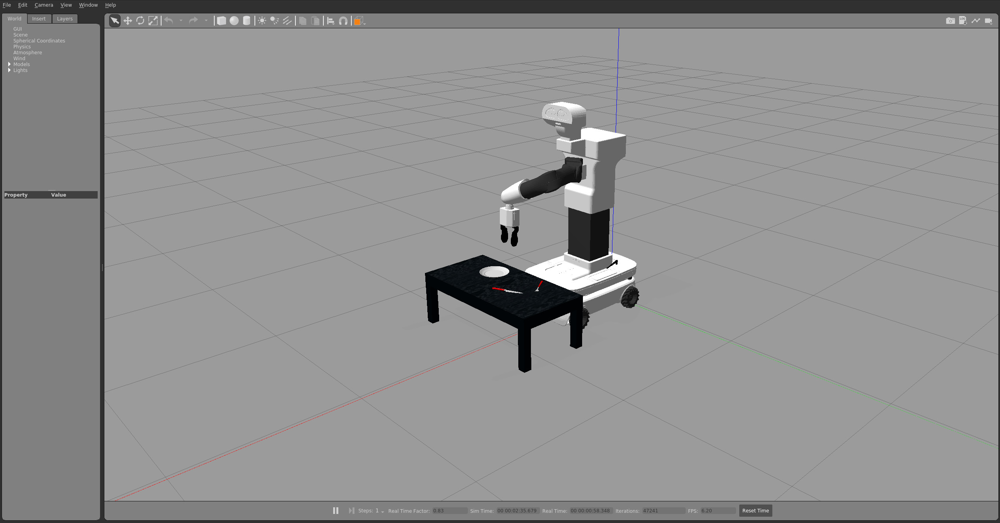
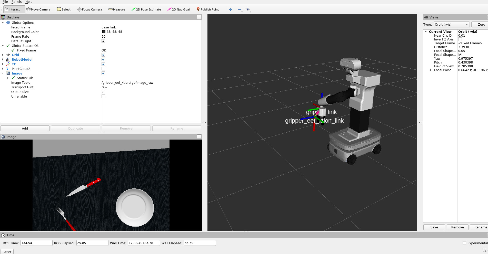

# Environnement Docker ROS Noetic pour TIAGo

Ce dossier contient l'environnement Docker ainsi que le workspace ROS
persistant du projet. Pour le guide complet, consulter le
[README principal](../README.md).

## Démarrage rapide

Depuis ce dossier :

```bash
./build.sh
./server.sh
./client.sh
```

Puis, dans le conteneur :

```bash
cd /home/pal/ros_ws
catkin_make -DCATKIN_ENABLE_TESTING=OFF -DDISABLE_PAL_FLAGS=ON
source /opt/pal/gallium/setup.bash
source devel/setup.bash --extend
./start_tiago_simulation.sh
```

La simulation ouvre Gazebo et RViz. Le script place TIAGo devant une table et
positionne son bras au-dessus de celle-ci. La caméra RGB-D, la profondeur et les
nuages de points peuvent être visualisés dans RViz.

Pour envoyer une pose 3D à la pince avec MoveIt, consulter la
[procédure de commande cartésienne](docs/robotique/commande_pose_3d_moveit.md).

## Persistance

Les montages utilisés par `server.sh` sont :

| Dossier local | Chemin dans le conteneur |
|---|---|
| `ros` | `/home/pal/.ros` |
| `workspace` | `/home/pal/ros_ws` |
| `share` | `/home/pal/share` |

Développer les packages ROS dans `workspace/src`. Les dossiers `build`,
`devel`, `install` et les logs sont générés localement et ignorés par Git.

## Conteneur et SSH

- Image : `epan/tiago:noetic`
- Conteneur : `epan-tiago-noetic-ssh`
- Port SSH : `2222`
- Utilisateur : `pal`

`client.sh` utilise directement `docker exec` ; une clé SSH n'est donc pas
requise pour ouvrir un terminal avec ce script.

## Captures




## Documentation TIAGo

Consulter le [manuel TIAGo](https://docs.pal-robotics.com/tiago-single/handbook.html)
pour les topics, contrôleurs et interfaces du robot.
