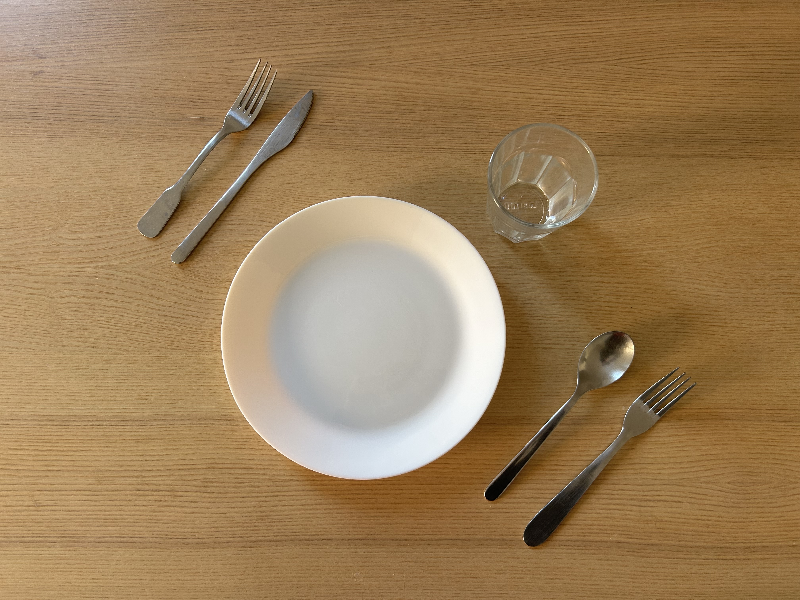
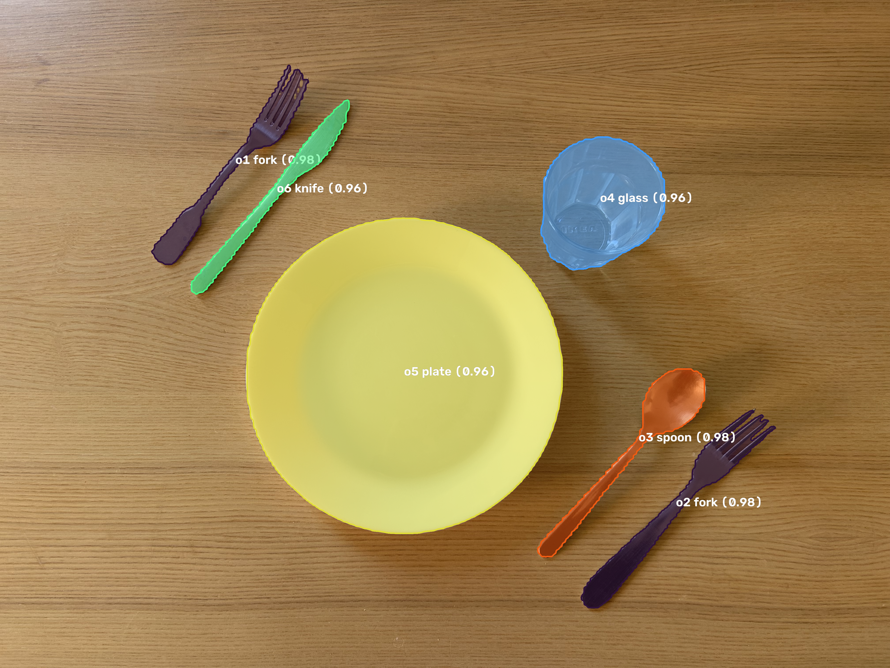
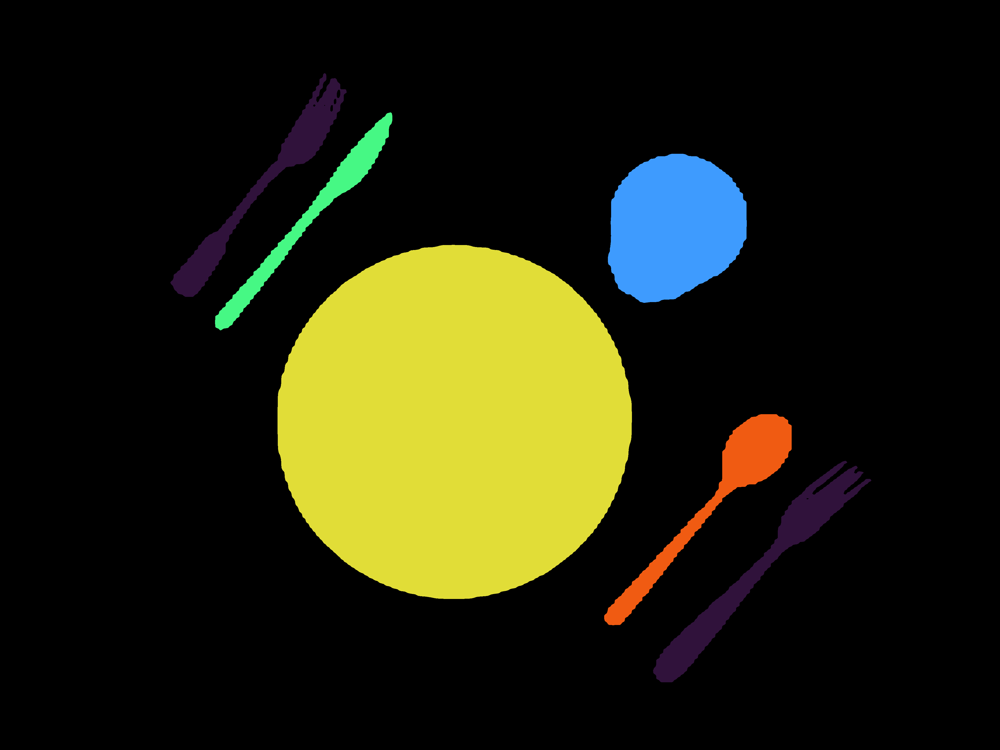

# Segmentation d'une scène : Qwen3-VL + SAM 3

Partie « photo → segmentation » du projet VA50. Script : `segmentation_qwen_sam3.py`

À partir d'une photo, on obtient un **masque par objet**, une **image sémantique**, un **prompt pour le générateur d'image** et un fichier **`scene.json`**.

| Photo | Overlay | Image sémantique |
|:---:|:---:|:---:|
|  |  |  |

---

## 1. Utilisation

Dans **Anaconda Prompt** :

**a) Vérifier son GPU et sa version de CUDA**

```bash
nvidia-smi
```

En haut à droite : `CUDA Version: XX.X` = version maximale gérée par ton pilote. Si la commande n'existe pas, il n'y a pas de GPU NVIDIA : le script tourne sur CPU, mais lentement.

**b) Créer l'environnement**

```bash
conda create -n va50 python=3.11 -y
conda activate va50
```

**c) Installer PyTorch** (adapté à ta version de CUDA)

Aller sur [pytorch.org](https://pytorch.org/get-started/locally/), choisir *Pip / Windows / CUDA* avec une version **inférieure ou égale** à celle de `nvidia-smi`, puis copier la commande proposée. Sans GPU : `pip install torch torchvision`.

Vérifier :

```bash
python -c "import torch; print(torch.__version__, torch.cuda.is_available())"
```

`True` = le GPU est utilisé.

**d) Installer le reste**

```bash
pip install -U transformers accelerate huggingface_hub opencv-python pillow numpy
```

**e) Accès à SAM 3** (une seule fois)

1. Compte sur [huggingface.co](https://huggingface.co), puis page **huggingface.co/facebook/sam3** : remplir le formulaire d'accès et attendre la validation.
2. *Settings → Access Tokens → New token* (type **Read**).
3. Dans le terminal : `huggingface-cli login` (ou `hf auth login` selon la version), puis coller le jeton.

Qwen3-VL est téléchargé automatiquement au premier lancement.

**f) Lancer**

```bash
cd chemin\du\projet
python segmentation_qwen_sam3.py photos\table5.jpeg
```

Avec une consigne pour le générateur (en anglais) :

```bash
python segmentation_qwen_sam3.py photos\table5.jpeg --instruction "Put the glass on the right"
```

| Option | Rôle | Défaut |
|---|---|---|
| `--vlm` | Modèle qui liste les objets | `Qwen/Qwen3-VL-2B-Instruct` |
| `--min_score` | Confiance minimale de SAM 3 | `0.50` |
| `--instruction` | Consigne ajoutée à l'`edit_prompt` | vide |

---

## 2. Ce qu'on obtient

```
out_pipeline/<photo>/
├── masks/        un masque noir et blanc par objet
├── semantic.png  une couleur par classe : 🟪 fork · 🟩 knife · 🟦 glass · 🟨 plate · 🟧 spoon
├── overlay.png   photo + masques + étiquettes (contrôle visuel)
└── scene.json    objets, scores, boîtes, chemins des masques, edit_prompt
```

| o1 fork | o2 fork | o3 spoon | o4 glass | o5 plate | o6 knife |
|:---:|:---:|:---:|:---:|:---:|:---:|
|  |  |  |  |  |  |

Extrait de `scene.json` :

```json
{
  "context": "dinner table",
  "edit_prompt": "Rearrange these objects into a neat dinner table setting: a plate, two forks, a knife, a spoon and a glass. Keep exactly the same objects, the same camera view and the same dinner table. Do not add or remove anything.",
  "count_mismatch": {},
  "objects": [
    {"id": "o1", "name": "fork", "score": 0.981,
     "bbox_px": [691, 303, 1395, 1199],
     "mask": "out_pipeline\\table5\\masks\\o1_fork.png"}
  ]
}
```

`bbox_px` = `[x1, y1, x2, y2]` en pixels. `count_mismatch` vide = les deux modèles trouvent le même nombre d'objets.

Lire un masque :

```python
import json, cv2
scene = json.load(open("out_pipeline/table5/scene.json", encoding="utf-8"))
for o in scene["objects"]:
    mask = cv2.imread(o["mask"], cv2.IMREAD_GRAYSCALE) > 0   # booléen H x W
```

---

## 3. Comment ça marche

```
photo ─► Qwen3-VL ─► liste d'objets (JSON : contexte, noms, nombres)
                          │
                          ├─► edit_prompt
                          ▼
         photo + chaque nom ─► SAM 3 ─► masques ─► nettoyage ─► fichiers
```

1. **Qwen3-VL** regarde la photo et liste les objets en JSON. Aucune liste n'est donnée à l'avance.
2. **L'`edit_prompt`** est assemblé par le code à partir de cette liste.
3. **SAM 3** reçoit un mot (« fork ») et renvoie **tous** les objets correspondants, chacun avec son masque et son score.
4. **Nettoyage** : plus grande zone connexe par masque, suppression du bruit (< 200 px) et des doublons (IoU > 0,7).

Vocabulaire : un **masque** est une image noir et blanc où le blanc marque l'objet ; l'**IoU** mesure le recouvrement entre deux masques ; l'**`edit_prompt`** est la consigne pour un générateur qui modifie la vraie photo.

---

## 4. Pourquoi deux modèles

- **Qwen3-VL** comprend la scène : il nomme et compte les objets, mais ne trace pas de contours précis.
- **SAM 3** découpe très précisément tout ce qui correspond à un mot, mais ne sait pas seul quoi chercher.

Qwen fournit les mots, SAM 3 les contours : le script marche sur une scène quelconque (table, bureau…) sans liste écrite à la main, avec des masques **nommés**.

**Modèles testés avant : Florence-2 + SAM 2.1**

| | Florence-2 + SAM 2.1 | Qwen3-VL + SAM 3 |
|---|---|---|
| Prompt de SAM | Points ou boîtes, pas de texte | Un mot suffit |
| Chaîne | Boîtes de Florence-2 → masques : une boîte fausse donne un masque faux | SAM 3 localise et découpe seul |
| Scène | Pas de contexte ni de comptage | Contexte, noms et nombres en JSON |
| Contrôle | Aucun | `count_mismatch` (VLM vs SAM 3) |

---

## 5. Limites

- Qwen3-VL 2B peut oublier un objet : il n'est alors ni segmenté ni dans l'`edit_prompt`. Vérifier `count_mismatch` et l'overlay.
- Deux objets de même nom ont la même couleur sur `semantic.png` : les distinguer avec `masks/` et les `id`.
- Noms d'objets et `--instruction` en **anglais** uniquement.
