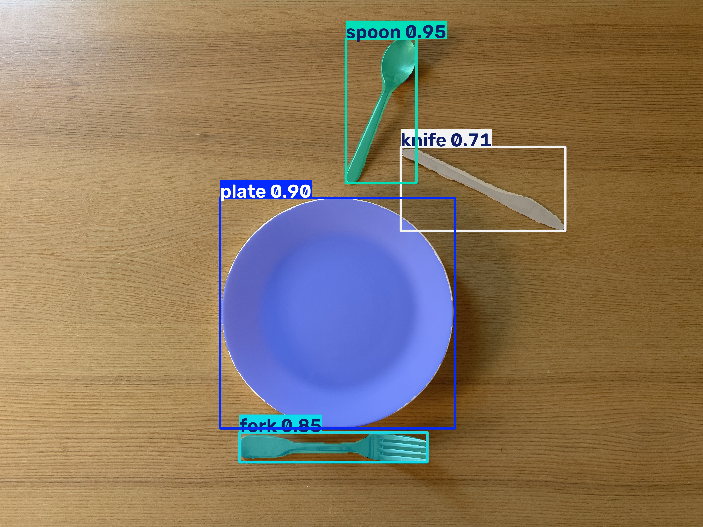
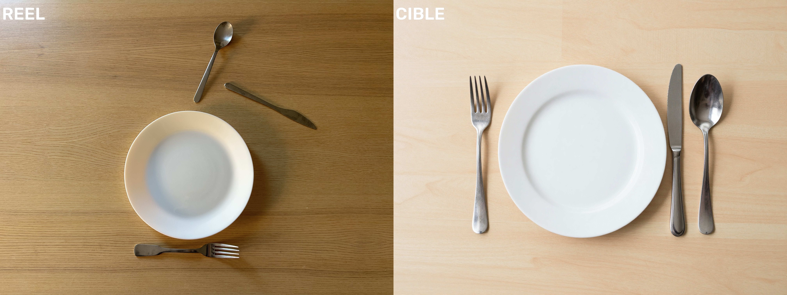
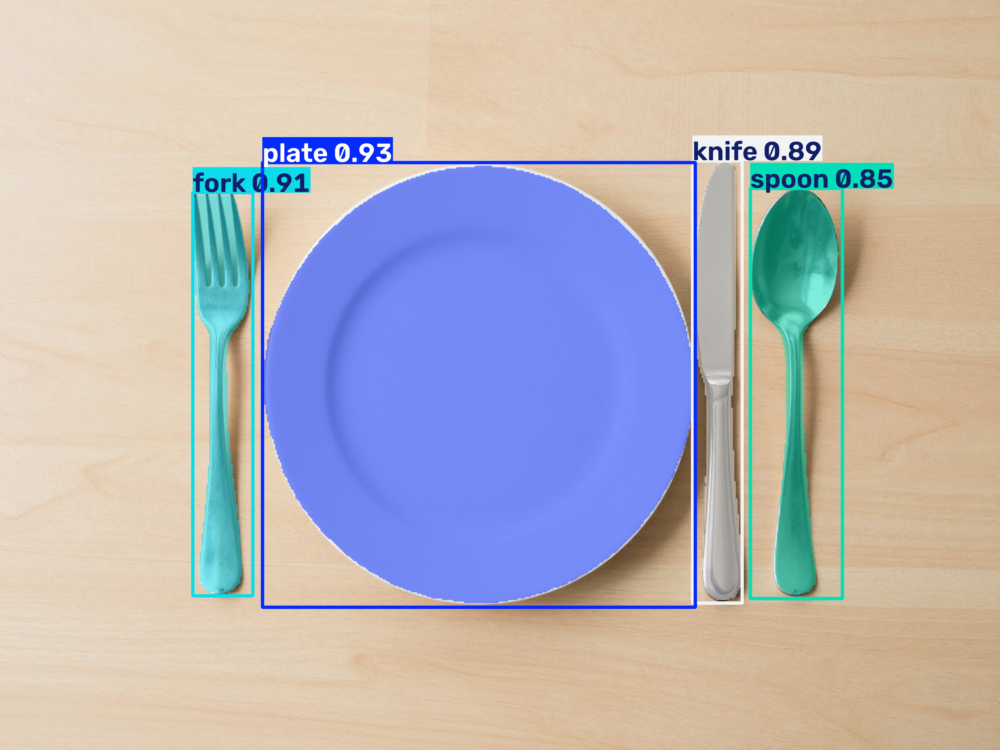
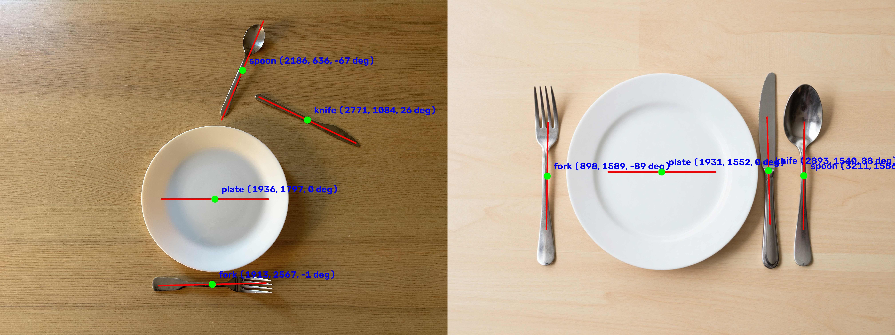

# Milestone 2 - Vision : image cible et déplacements des objets

Ce dossier couvre les tickets 1 et 2 du Milestone 2. À partir d'une photo de table vue de dessus, il :

1. **génère une image cible**, c'est-à-dire la même table rangée « comme le ferait un humain » (ticket 1) ;
2. **calcule le déplacement de chaque objet** (Δx, Δy, Δθ) pour passer de la photo à l'image cible (ticket 2).

Tout se lance avec **une seule commande**.

---

## Fonctionnement

```
photo ──► YOLOE ──► objets {plate: 1, fork: 1, knife: 1, spoon: 1}
                         │
                         ▼
              LLM Qwen3-4B : rédige le prompt (objets exacts + disposition voulue)
                         │
                         ▼
              Z-Image-Turbo : génère l'image cible à partir du texte seul
                         │
                         ▼
              YOLOE : vérifie qu'on retrouve les mêmes objets
                         │
                         ▼
              Ticket 2 : poses (x, y, θ) des deux images ► matching ► Δx, Δy, Δθ
```

### 1. Sémantique de la photo (YOLOE)

YOLOE détecte les objets de la photo réelle : boîte, masque, classe et score.



### 2. Génération de l'image cible

Un LLM (Qwen3-4B) rédige le prompt. Il reçoit la liste exacte des objets, leur disposition voulue (fourchette à gauche de l'assiette, couteau à droite, cuillère à droite du couteau) et un exemple de prompt qui fonctionne. Z-Image-Turbo génère ensuite l'image **sans la photo**, et le résultat est remis aux dimensions de la photo.



YOLOE repasse sur l'image générée pour vérifier qu'elle contient **les mêmes objets en mêmes quantités**.



### 3. Déplacements (ticket 2)

Pour chaque objet des deux images, on calcule :
- son centre (x, y), avec `find_center` ;
- son angle θ, avec `find_angle`, entre -90° et 90°.

On associe ensuite les objets de même classe, puis on calcule les déplacements. Sur l'image de contrôle, le **point vert** marque le centre et le **trait rouge** l'axe de chaque objet.



| objet | réel (x, y, θ) | cible (x, y, θ) | Δx | Δy | Δθ |
|---|---|---|---|---|---|
| fork  | (1913, 2567, -1°)  | (898, 1589, -89°)  | -1014 | -978 | -88° |
| knife | (2771, 1084, 26°)  | (2893, 1540, 88°)  | +122  | +456 | +63° |
| plate | (1936, 1797, 0°)   | (1931, 1552, 0°)   | -5    | -245 | 0°   |
| spoon | (2186, 636, -67°)  | (3211, 1586, -90°) | +1025 | +950 | -22° |

**Conventions :**
- les valeurs sont en **pixels** ; x pointe vers la droite et y **vers le bas** ;
- θ = 0° correspond à l'horizontale, et un angle positif tourne dans le sens horaire à l'écran ;
- un couvert n'a pas de sens, donc Δθ est ramené entre -90° et 90° pour obtenir la plus petite rotation ;
- l'assiette, ronde, a toujours θ = 0.

---

## Mise en place du workspace

**Prérequis :** Windows, Python 3.10 ou plus récent, un GPU NVIDIA avec au moins 8 Go de VRAM, et environ 15 Go d'espace disque libre.

**1. Installer les dépendances**, dans PowerShell, depuis le dossier `code_suite` :
```powershell
py -m pip install torch torchvision --index-url https://download.pytorch.org/whl/cu128
py -m pip install ultralytics diffusers transformers accelerate gguf bitsandbytes truststore
```
Sur Windows, utilise `py` plutôt que `python`, qui peut ouvrir le Microsoft Store.

**2. Placer le modèle YOLOE** dans `models/yoloe-26l-seg.pt`. Les fichiers `.pt` ne sont pas versionnés dans git.

**3. Vérifier que le GPU est reconnu :**
```powershell
py -c "import torch; print(torch.cuda.is_available(), torch.cuda.get_device_name(0))"
```
La commande doit afficher `True` puis le nom de la carte.

Au **premier lancement**, environ 12 Go de modèles se téléchargent automatiquement depuis Hugging Face (Z-Image-Turbo et Qwen3-4B), ce qui prend quelques minutes. Les lancements suivants sont rapides.

---

## Utilisation

```powershell
py generate_from_semantics.py images/table2.jpeg              # tout le pipeline (~1 min 30)
py generate_from_semantics.py images/table2.jpeg --tries 3    # 3 images, garde la meilleure
py generate_from_semantics.py images/table2.jpeg --seed 0     # résultat reproductible
py compare_poses.py images/table2.jpeg outputs/<nom>_target.png   # ticket 2 seul
```

Les résultats sont enregistrés dans `outputs/` :

| Fichier | Contenu |
|---|---|
| `…_target.png` | Image cible, aux mêmes dimensions que la photo |
| `…_compare.jpg` | Photo et cible côte à côte |
| `…_seg_reel.jpg` / `…_seg_cible.jpg` | Segmentation YOLOE des deux images |
| `…_poses.jpg` | Contrôle des centres et des angles |
| `…_moves.json` | Déplacements Δx, Δy, Δθ, pour le ticket suivant |
| `….json` | Graine, prompt et objets de la génération |

## Fichiers

| Fichier | Rôle |
|---|---|
| `generate_from_semantics.py` | **Script principal** : enchaîne toutes les étapes |
| `yoloe_semantics.py` | YOLOE : liste et nombre des objets d'une image |
| `prompt_llm.py` | Rédaction du prompt par le LLM |
| `zimage_generator.py` | Génération Z-Image-Turbo, en version allégée pour 8 Go de VRAM |
| `compare_poses.py` | Ticket 2 : poses, matching et déplacements |
| `extract_segmentation_position_orientation.py` | Module YOLOE de poses (`find_center`, `find_angle`) |

## Limites

- Les déplacements sont en **pixels**. La conversion en mètres relève du ticket 3.
- L'image cible est une **autre scène** que la photo : la table et le zoom diffèrent, donc les Δx et Δy restent approximatifs.
- Le modèle génère parfois un objet en trop ou en moins. YOLOE le signale, et `--tries 3` permet de garder la meilleure image.
